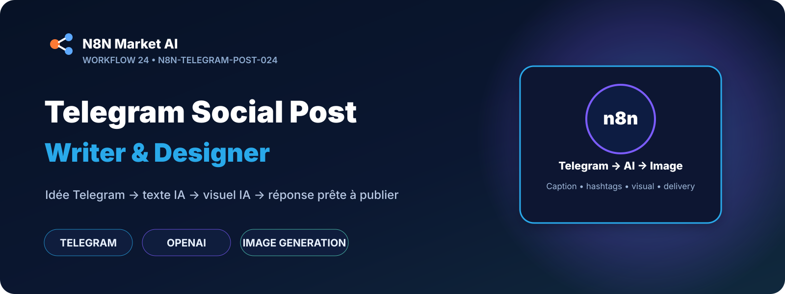
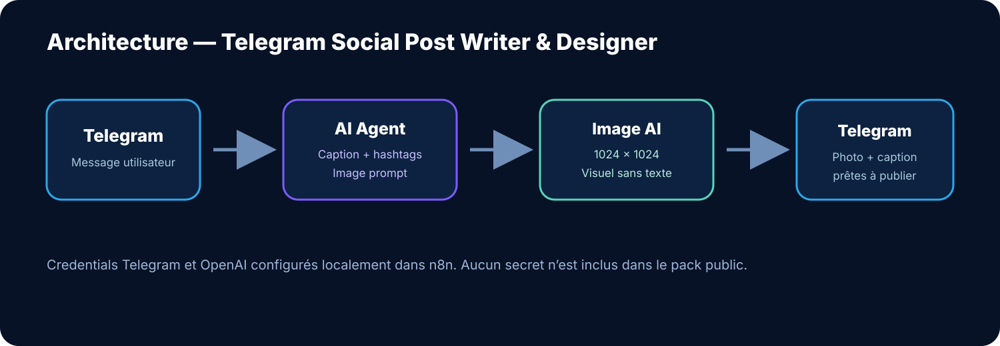

# Telegram Social Post Writer & Designer — n8n

> **Un workflow n8n qui transforme une idée envoyée sur Telegram en une publication sociale complète : caption, emojis, hashtags et visuel généré par IA, puis renvoie le résultat directement dans Telegram.**

[**🛒 Acheter le workflow — 29 € →**](https://n8nmarketai.com/products/telegram-social-post-writer-designer)

## 🛒 Offre N8N Market AI

| | |
|---|---|
| 💰 **Prix** | **29 €** |
| 📌 **Statut** | **🟢 PUBLIÉ** |
| 📦 **Livraison** | Workflow n8n + guide de configuration |
| 🧩 **Niveau** | Facile à intermédiaire |
| 🔧 **Personnalisation** | Prompt, ton, hashtags, modèle IA et format image |
| 💬 **Interface** | Telegram |

---

## Ce que fait le workflow

L'utilisateur envoie simplement son idée au bot Telegram.

Le workflow :

- récupère automatiquement le message Telegram ;
- extrait le `chatId` et le texte utilisateur ;
- envoie un message d'attente ;
- utilise un agent IA pour rédiger une publication prête à publier ;
- conserve la langue de la demande ;
- limite la caption à moins de 900 caractères ;
- ajoute emojis, appel à l'action et 3 à 6 hashtags ;
- génère un `image_prompt` détaillé en anglais ;
- crée automatiquement un visuel carré 1024 × 1024 ;
- renvoie la photo accompagnée de la caption directement dans Telegram.

## Architecture

**Telegram → Agent IA → Structured Output → Génération d'image → Telegram**

## Démonstration / workflow n8n

[Ouvrir Telegram Social Post Writer & Designer dans n8n](https://faouzi-guerrida.n8n-wsk.com/workflow/A2OvDA2BfE7usbB0)

## Prérequis

- n8n ;
- un bot Telegram ;
- credentials Telegram configurés dans n8n ;
- compte OpenAI ;
- credentials OpenAI configurés dans n8n.

## Sécurité et distribution

- aucun token Telegram n'est publié ;
- aucune clé API OpenAI n'est publiée ;
- aucun credential n8n personnel n'est inclus ;
- aucun `instanceId` privé n'est publié ;
- **le fichier JSON importable du workflow n'est pas publié sur GitHub** ;
- le workflow complet est conservé dans le pack privé Google Drive.

## Fichier livré

Le pack privé contient notamment :

- `Telegram Social Post Writer & Designer.json` ;
- guide d'installation ;
- informations de configuration Telegram/OpenAI.

Après import dans n8n, il suffit de reconnecter vos propres credentials Telegram et OpenAI.

---

## Créez vos posts sociaux directement depuis Telegram

[**🛒 Acheter Telegram Social Post Writer & Designer — 29 € →**](https://n8nmarketai.com/products/telegram-social-post-writer-designer)

[← Retour au catalogue N8N Market AI](../../README.md)
